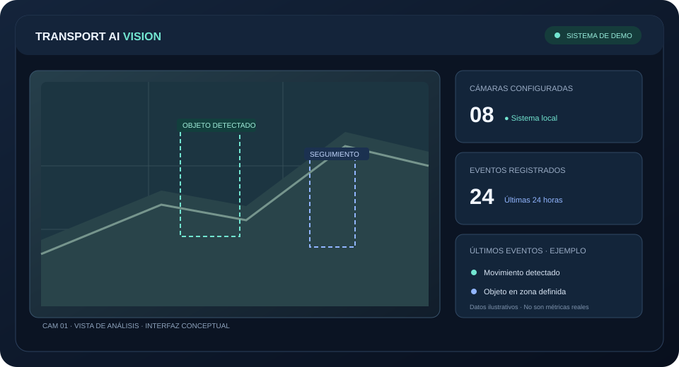
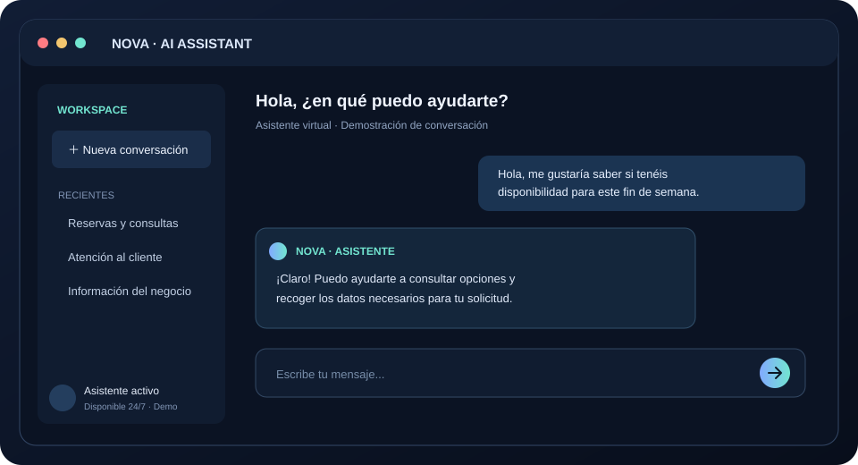
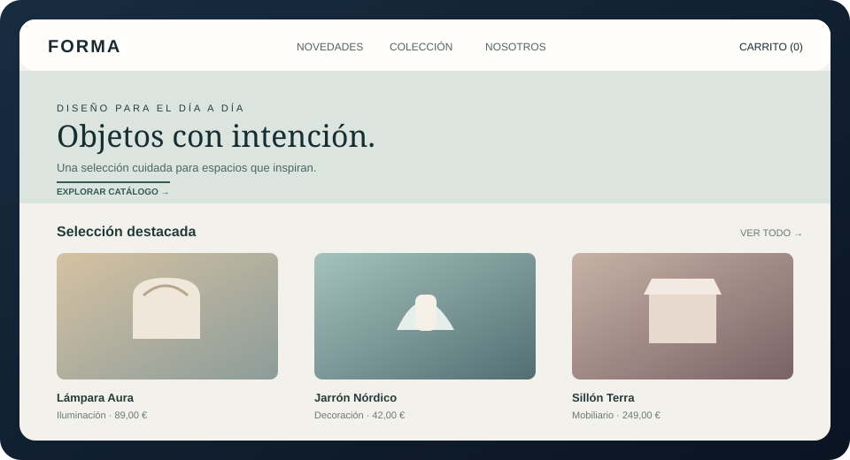

# Álvaro Chaveinte Camargo
### Fundador de Transport AI · Desarrollo de software · Inteligencia artificial aplicada · Automatización

  
  
  
  

**Construyo tecnología para resolver problemas reales.** Soy Álvaro Chaveinte Camargo, fundador de [Transport AI](https://transportai.es), una iniciativa desde la que diseño y desarrollo software, automatizaciones y soluciones basadas en inteligencia artificial para empresas.

Mi trabajo combina programación y visión de producto. Me implico en el proceso completo: escuchar una necesidad, entender cómo trabaja el negocio, convertirla en requisitos, diseñar una experiencia, desarrollar un prototipo, probarlo y explicar su valor mediante una demostración.

He creado proyectos propios y demos aplicadas a logística, transporte, alojamientos, restauración y operaciones. Los presento de forma transparente según su estado: desarrollo activo, MVP, prototipo o demostración; no los describo como productos comerciales terminados cuando no lo son.

- **Ubicación:** Comunidad de Madrid, España.
- **Portfolio web:** [Ver portfolio](https://github.com/Transport-AI1/Portafolios-transport-ai)
- **Empresa:** [transportai.es](https://transportai.es)
- **GitHub:** [@Transport-AI1](https://github.com/Transport-AI1)
- **Contacto profesional:** [contacto@transportai.es](mailto:contacto@transportai.es)

---

## Perfil profesional: qué aporto

- **Iniciativa y autonomía:** impulso proyectos propios, organizo el trabajo y busco la forma de llevar una idea a una primera versión comprobable.
- **Mentalidad de producto:** intento comprender al usuario y el proceso antes de decidir qué tecnología utilizar.
- **Visión técnica de extremo a extremo:** trabajo con interfaces, lógica de backend, APIs, bases de datos e integraciones.
- **IA aplicada:** exploro casos de uso concretos para agentes, asistentes, automatización y análisis visual.
- **Comunicación:** preparo demostraciones personalizadas, explico funcionalidades y recojo feedback para mejorar las propuestas.
- **Aprendizaje práctico:** amplío conocimientos construyendo, probando, leyendo documentación y corrigiendo problemas reales.

## Áreas de desarrollo

| Área | Trabajo que realizo |
|---|---|
| Aplicaciones web | Dashboards, paneles internos, portales, herramientas de gestión e interfaces responsive. |
| Backend y APIs | Servicios Python, APIs REST, lógica de negocio e integración entre plataformas. |
| Automatización | Flujos de trabajo, notificaciones, sincronización de datos y reducción de tareas repetitivas. |
| Agentes IA | Prototipos conversacionales y de voz, recepción digital, consultas y apoyo a reservas. |
| Visión artificial | Procesamiento de imágenes y vídeo, análisis de eventos, anomalías y evidencias. |
| Datos y sistemas | Bases de datos, persistencia de eventos, registros y herramientas operativas. |
| Desarrollo de producto | Análisis funcional, prototipado, demostraciones, pruebas, iteración y despliegue. |

## Tecnologías y herramientas

Tecnologías utilizadas en diferentes proyectos. La profundidad y el nivel de experiencia varían según la herramienta; no presento toda la lista como experiencia profesional avanzada.

- **Frontend:** HTML5, CSS3, JavaScript, TypeScript, React, Next.js y Tailwind CSS.
- **Backend:** Python, FastAPI, APIs REST e integración de servicios.
- **Datos:** Supabase, PostgreSQL, SQLite y Neon.
- **IA y agentes:** Voiceflow, GPT4All, Ollama e integración de modelos.
- **Visión artificial:** OpenCV, procesamiento de imágenes y vídeo.
- **Herramientas:** Git, GitHub, Visual Studio Code y Vercel.
- **Producto:** dashboards, interfaces responsive, prototipado, documentación y generación de informes PDF.

---

## Proyectos seleccionados

Los siguientes proyectos muestran experiencia práctica. Su estado se indica en cada apartado.

### 1. Transport AI Vision
**Visión artificial · Desarrollo activo**

Sistema en desarrollo para analizar imágenes y vídeo de cámaras y facilitar la revisión de eventos e incidencias.

- Backend desarrollado con Python y FastAPI.
- Procesamiento de imágenes y vídeo mediante OpenCV.
- Motor de análisis de anomalías basado en reglas y baseline estadístico.
- Registro de eventos, muestras y evidencias en SQLite.
- Gestión de cámaras, historial y revisión de incidencias.
- Trabajo en notificaciones, informes y evolución del panel de control.

**Stack:** Python, FastAPI, OpenCV, SQLite, TypeScript / React.  
[Repositorio Transport AI Vision](https://github.com/Transport-AI1/transport-ai-vision)

### 2. MVP de gestión logística
**Aplicación web · MVP en evolución**

Aplicación para centralizar operaciones logísticas, pedidos, estados de entrega e incidencias.

- Panel de gestión y vistas operativas.
- Gestión de pedidos y estados.
- Registro y seguimiento de incidencias.
- API y persistencia de información.
- Evolución hacia perfiles y flujos operativos.

**Stack:** Next.js, TypeScript, Supabase y Vercel.  
[Ver aplicación](https://transport-ai1-logistica.vercel.app) · [Repositorio](https://github.com/Transport-AI1/mvp-logistica)

### 3. Recepción IA para hoteles y alojamientos
**Agentes conversacionales · Demos**

Prototipos de recepción digital adaptados a establecimientos hoteleros, orientados a responder consultas, presentar información y explorar procesos de reserva.

- Demostración para Hotel Boutique Pinar.
- Demostración para Aqua Bellamar.
- Diseño de flujos conversacionales y experiencia de recepción.
- Exploración de integraciones con canales de comunicación y sistemas externos.

**Stack:** Next.js, TypeScript, Voiceflow y APIs.  
[Demo Hotel Boutique Pinar](https://transport-ai-hotel-pinar.vercel.app) · [Demo Aqua Bellamar](https://aqua-bellamar-demo.vercel.app)

### 4. Tienda online — concepto visual
**Diseño e-commerce · Demostración conceptual**

Diseño conceptual para ilustrar una posible tienda digital con catálogo, navegación y presentación de productos. Es una muestra visual de diseño, no una tienda publicada ni un proyecto comercial entregado.

### 5. Transport AI Virtual Office
**Entorno de trabajo digital · Prototipo**

Entorno de trabajo virtual concebido para organizar tareas, herramientas y futuros agentes especializados.

**Stack:** Next.js, TypeScript, APIs y GPT4All.  
[Repositorio](https://github.com/Transport-AI1/transport-ai-virtual-office)

### 6. Chat AI 20
**Workspace de inteligencia artificial · Desarrollo de producto**

Proyecto de espacio de trabajo basado en IA, planteado para reunir herramientas y áreas especializadas en una aplicación.

**Stack:** Next.js, TypeScript e integraciones de IA.  
[Repositorio](https://github.com/Transport-AI1/Chat-AI-20)

### 7. Experiencias digitales para negocios
**Web development · Demos y prototipos**

Diseño y desarrollo de experiencias web adaptadas a alojamientos, restauración y ocio, con interfaces responsive, contenido específico y recorridos digitales.

[Explorar repositorios](https://github.com/Transport-AI1)

---

## Cómo trabajo

1. **Escuchar y entender:** conocer el proceso, los usuarios y el problema que se quiere resolver.
2. **Definir:** convertir la necesidad en funcionalidades y criterios concretos.
3. **Diseñar:** plantear una experiencia y una arquitectura proporcionadas al objetivo.
4. **Construir:** desarrollar interfaz, backend, datos e integraciones.
5. **Probar y demostrar:** validar los flujos, enseñar el resultado y recoger feedback.
6. **Iterar:** corregir, documentar y preparar la siguiente versión.

## Sectores y casos de uso

- **Transporte y logística:** seguimiento de operaciones, entregas, incidencias, coordinación y avisos.
- **Hoteles y alojamientos:** recepción digital, consultas, información del establecimiento y asistencia en reservas.
- **Restauración y ocio:** experiencias web, consultas, reservas y atención al cliente.
- **Servicios y operaciones:** gestión de solicitudes, automatización de tareas y centralización de información.

## Qué oportunidades me interesan

Estoy abierto a oportunidades junior, colaboraciones y proyectos donde pueda seguir creciendo y aportar trabajo práctico en:

- Desarrollo de software y aplicaciones web.
- Desarrollo junior con Python y APIs.
- Frontend / full-stack junior.
- Inteligencia artificial aplicada y agentes IA.
- Automatización e integración de sistemas.
- Visión artificial y procesamiento de imágenes o vídeo.
- Desarrollo de producto, prototipado y validación.

Me interesa trabajar con equipos que valoren la iniciativa, la comunicación, la responsabilidad y las ganas de aprender construyendo.

## Contacto

¿Tienes una oportunidad profesional, una colaboración o un proyecto tecnológico?

- **Email:** [contacto@transportai.es](mailto:contacto@transportai.es)
- **Web:** [transportai.es](https://transportai.es)
- **GitHub:** [Transport-AI1](https://github.com/Transport-AI1)

<strong>Ideas convertidas en productos. Tecnología aplicada a problemas reales.</strong>

